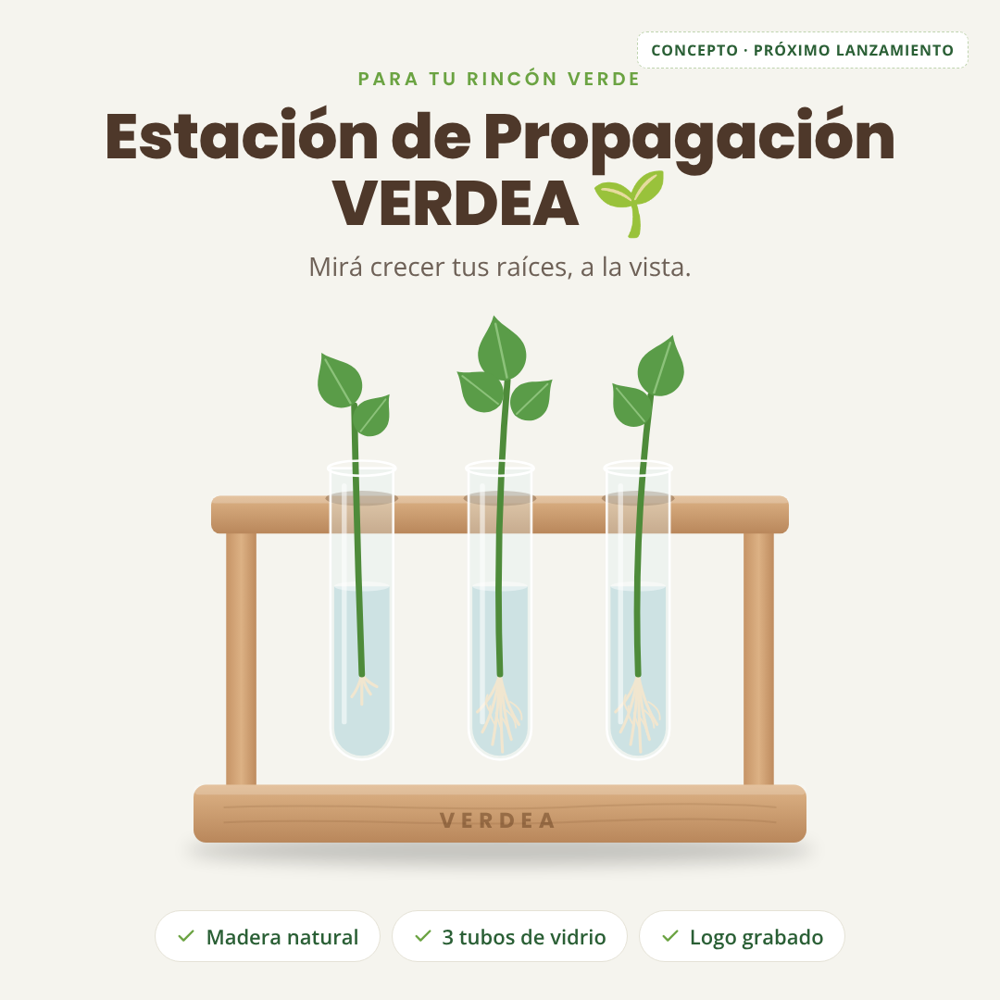

# Estación de Propagación VERDEA · ficha del producto
*(propuesta · octubre 2026 · para **Lucía**, "la que ya tiró demasiados esquejes")*

## Qué es
Una base de madera con **3 tubos de vidrio** para enraizar esquejes en agua, a la vista. Es
herramienta y objeto de deco a la vez: va en la ventana, en un estante o en el escritorio, y
convierte el "frasco con un gajo" en un rincón lindo de la casa.

## Por qué es el próximo producto de VERDEA
- **Es el ritual de Lucía.** Ella ya propaga potus, monsteras y gomeros en agua y se le pudren.
  La estación le da un lugar para hacerlo bien y **ver** cómo crecen las raíces.
- **Hace que el enraizante se use más.** Cada esqueje nuevo es una excusa para usar VERDEA, y eso trae recompra.
- **Encaja con tu identidad** ("tu rincón verde, tu momento de paz"): es lindo, natural y tranquilo.
- **Se demuestra solo en video.** Ver crecer raíces en el vidrio, semana a semana, es contenido que no necesita guion.
- **Casi no hay competencia local.** En Mercado Libre lo que aparece es **importado a $88.501–$155.484**
  (con envío desde China) y algún modelo de pared a ~$13.800 [ML]. Uno local, lindo y a precio
  medio no existe.
- **Es regalo.** Sube la conversión en fechas (Navidad, Día de la Madre, cumpleaños) y abre la puerta a otro público.

## Cómo sería (propuesta)
| | |
|---|---|
| Medidas | ~35 cm de largo × 9 cm de profundidad × 20 cm de alto |
| Base | Madera maciza (pino o paraíso) con aceite natural **o** terciado/fibrofácil cortado a láser |
| Tubos | 3 tubos de vidrio de 20–25 mm × 150 mm, desmontables para lavarlos |
| Marca | "VERDEA" grabado a láser en el frente de la base |
| Packaging | Caja de cartón kraft con separadores para cada tubo + tarjeta "cómo propagar" |

## De dónde sacarlo (2 caminos)
1. **Corte láser (más barato y escalable).** Ya hay diseños para estaciones con tubos de 20 mm × 150 mm
   en terciado de 3–4 mm [Web]. Un taller de corte láser corta y graba el logo en el mismo paso.
   Pedí presupuesto por 50 y por 100 unidades.
2. **Carpintería (más premium).** Base de madera maciza con agujeros pasantes. Más lindo y más caro;
   conviene si querés posicionarlo como objeto de diseño.

**Tubos:** en Mercado Libre hay tubos de vidrio con tapa de 16 × 150 mm a $14.651 el pack de 10
(~$1.465 c/u) [ML]. Los de 20–25 mm suelen costar algo más: pedí precio por 150–300 unidades a
proveedores de laboratorio.

## Números (estimados, hay que confirmarlos con presupuestos)
| | Costo estimado |
|---|---|
| Base cortada y grabada | $3.000 – $5.000 |
| 3 tubos de vidrio | $4.500 – $6.000 |
| Packaging con separadores + tarjeta | $1.500 – $2.000 |
| **Total por estación** | **$9.000 – $13.000** [Estimado] |

| Oferta | Precio | Margen antes de anuncios | CPA de equilibrio | ROAS de equilibrio |
|---|---|---|---|---|
| Estación sola (costo $9.000–$13.000) | $34.900 | $11.026 – $15.026 (32–43%) | $11.026 – $15.026 | 2,3 – 3,2 |
| **Kit Estación + Enraizante** (costo combinado $17.000–$21.000) | **$79.900** | $35.626 – $39.626 (45–50%) | $35.626 – $39.626 | 2,0 – 2,2 |
| Kit con envío gratis | $79.900 | $26.626 – $30.626 (33–38%) | $26.626 – $30.626 | 2,6 – 3,0 |

> El **kit** es lo más fuerte: un CPA de equilibrio de ~$30.000–$40.000 deja muchísimo aire para pagar anuncios.
> Por separado saldría $92.900 ($34.900 + $58.000): el kit a $79.900 te ahorra $13.000 y se entiende en un segundo.
> El costo del enraizante lo supuse en ~$8.000: reemplazalo por el real.

## Cómo venderlo
- **Dentro de la tienda VERDEA:** como producto propio, como **kit con el enraizante** y como
  "agregá la estación" en la página del enraizante.
- **Ángulos para Lucía:**
  1. *Deseo:* "Mirá crecer tus raíces." Time-lapse de un esqueje en el tubo.
  2. *Dolor:* "Si se te pudren los esquejes en el frasco, el problema no sos vos." (agua estancada, sin luz, sin estímulo).
  3. *Regalo:* "El regalo para la amiga que llena la casa de plantas."
- **Contenido orgánico:** una "serie" semanal mostrando el mismo esqueje en la estación hasta que va a maceta.
  Ojo: **solo con fotos y videos reales** (regla de VERDEA): las ilustraciones son para presentar el concepto.

## Cuándo lanzarlo
- **Condición:** que el enraizante tenga ventas estables en el test con Lucía y Marta.
- El **Día de la Madre es mañana (18/10)**: no llegamos. La próxima gran fecha es **Navidad**.
- **Plan para llegar a Navidad:**
  1. Semana del 19/10: pedir 3 presupuestos (corte láser, carpintería y tubos). No cuesta nada.
  2. Fines de octubre: pedir **1 muestra** y sacarle fotos y videos reales.
  3. 10/11: decidir si se lanza, con los números del test del enraizante.
  4. Mediados de noviembre: producir 50 unidades y testear el kit con Lucía hasta el 15/12 (última fecha segura para envíos de Navidad).

## Riesgos y cómo cubrirlos
| Riesgo | Qué hacer |
|---|---|
| Vidrio que se rompe en el envío | Separadores de cartón, tubos envueltos, reserva por roturas del 5% y tubos de repuesto |
| Calidad de la madera o del corte | Pedir muestra antes de producir; aceite o barniz al agua |
| Que la estación "canibalice" al enraizante | Venderla siempre en kit o como agregado, nunca como reemplazo |
| Promesas sobre resultados | Hablar de "ver crecer raíces", no prometer tiempos ni porcentajes |

## Mensaje para pedir presupuesto (copiar y pegar)
> Hola, ¿cómo va? Tengo una marca de productos para plantas y quiero producir una **estación de propagación**:
> una base de ~35 × 9 cm con un travesaño a ~20 cm de alto y **3 agujeros para tubos de 20–25 mm**,
> con nuestro logo **grabado a láser** en el frente. ¿Me pasarías precio por **50 y por 100 unidades**
> en terciado/fibrofácil de 4 mm (y, si hacen, en madera maciza), con tiempo de entrega? Tengo el archivo
> en SVG. ¡Gracias!

Fuentes: [ML hidroterrario / estaciones de propagación](https://listado.mercadolibre.com.ar/hidroterrario) · [Atomm: estación con tubos de 20 × 150 mm en terciado de 3 mm](https://www.atomm.com/es/project/150625-monstera-leaf-wall-planter-with-2-glass-propagation-tubes) · [Cuttle: archivo SVG de soporte para tubos](https://cuttle.xyz/@bwente/Tube-Racks-9pb7UK0G2Fsw) · [ML tienda ABC LAB (tubos de vidrio)](https://www.mercadolibre.com.ar/tienda/abc-lab)
